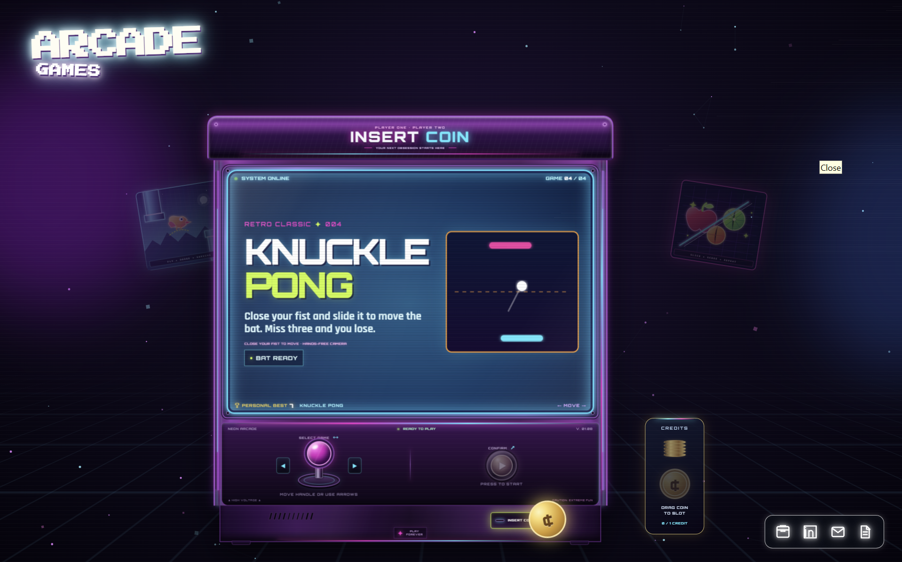
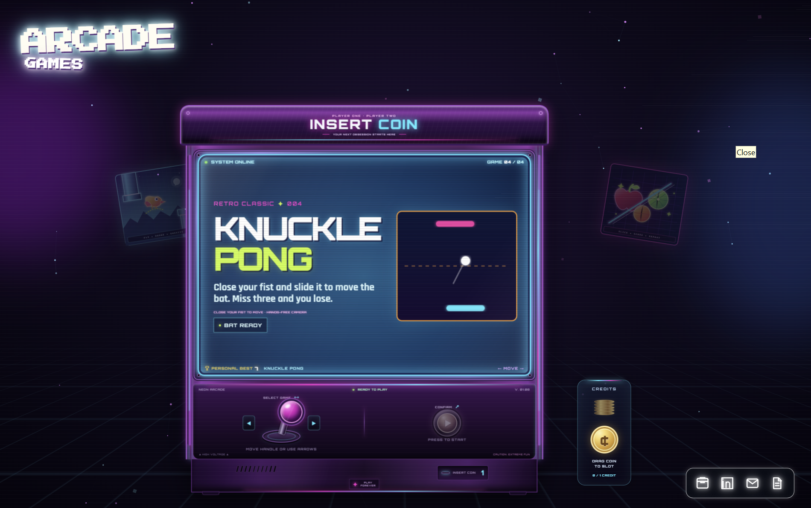

# Neon Arcade

### [▶ PLAY LIVE — https://gesturearcade.netlify.app/](https://gesturearcade.netlify.app/)

A browser-based retro arcade featuring four interactive games controlled through webcam-based hand and face tracking, with keyboard and mouse controls as alternatives.

Built using vanilla HTML, CSS and JavaScript, with no frameworks or build process required.

Preview

<p align="center">
  
</p>

<p align="center">
  
</p>

## Games

## Games

The arcade currently includes four playable games. Each game runs inside the arcade cabinet interface and has its own controls and gameplay logic.

### 1. Blink Bird

**Controls:** Blink to jump, or use Space, Arrow Up or tap.

A Flappy Bird-style game where the player controls the bird using eye blinks detected through the webcam.

The game uses MediaPipe Face Landmarker to track facial landmarks and detect eye closure. When a blink is detected, the bird jumps. A detection delay prevents a single blink from triggering multiple jumps.

Keyboard and touch controls are also available.

### 2. Fruit Ninja

**Controls:** Move your fingertip through fruit, or use mouse, touch, arrow keys or WASD.

A fruit-cutting game controlled through hand tracking.

MediaPipe Hand Landmarker detects the player's hand and tracks the index fingertip. The fingertip movement creates a cutting trail, and fruit is sliced when the trail intersects it.

The game includes fruit spawning, collision detection, scoring, and visual effects.

### 3. Rock Paper Scissors

**Controls:** Show rock, paper or scissors to the camera, or press R, P or S.

A camera-based version of the classic Rock Paper Scissors game.

MediaPipe Hand Landmarker detects hand landmarks and identifies the player's gesture. The detected gesture is compared against the computer's randomly selected move to determine the result.

The game keeps track of rounds and scores.

### 4. Knuckle Pong

**Controls:** Close your fist and move your hand to control the paddle, or use mouse and keyboard.

A Pong-style game where hand movement controls the player's paddle.

MediaPipe Hand Landmarker tracks the hand and detects whether the player has closed their fist. The hand's position controls the paddle movement, while an AI opponent controls the other side.

The objective is to return the ball and score points against the opponent.

## How the Arcade Works

The project uses a modular structure, keeping the main arcade interface separate from individual games.

- **Home screen:** Displays the arcade cabinet and available games. Players can browse games using the draggable joystick.
- **Coin mechanism:** Players insert a virtual coin to unlock the arcade.
- **Game launcher:** Loads the selected game inside the cabinet screen.
- **Camera manager:** Handles webcam access and ensures that only one camera stream is active at a time.
- **Game registry:** Maintains the list of games and loads them when selected.
- **Personal records:** Stores each game's best score in browser localStorage.

The webcam is requested only after the player presses Start Game. It is released when the player exits the game.

## Project Structure

```text
neon-arcade/
├── index.html
├── styles.css
├── README.md
│
├── src/
│   ├── main.js
│   ├── backgroundFX.js
│   ├── home/
│   ├── components/
│   ├── services/
│   ├── styles/
│   └── games/
│       ├── flappy-bird/
│       ├── fruit-ninja/
│       ├── pong/
│       └── rock-paper-scissors/
│
├── assets/
│   ├── result.png
│   ├── result2.png
│   ├── games/
│   └── vendor/
│       └── mediapipe/
│
└── tests/
    ├── blink.test.mjs
    ├── fruit-ninja.test.mjs
    ├── pong.test.mjs
    ├── rps.test.mjs
    └── fruit-ninja.e2e.py
```

## Running Locally

The project uses JavaScript ES modules and webcam access, so it needs to run through a local HTTP server rather than opening the HTML file directly.

**Using Python:**

```bash
python -m http.server 8000
```

Open the following address in your browser:

```text
http://localhost:8000
```

Alternatively, use the VS Code Live Server extension.

## Running Tests

The project includes basic tests for game logic and detection behaviour.

Run the tests from the project root:

```bash
node tests/blink.test.mjs
node tests/fruit-ninja.test.mjs
node tests/pong.test.mjs
node tests/rps.test.mjs
```

## Technologies Used

| Area | Technology |
|---|---|
| Frontend | HTML5, CSS3 |
| Programming | Vanilla JavaScript (ES2022+) |
| Hand Tracking | MediaPipe Hand Landmarker |
| Face Tracking | MediaPipe Face Landmarker |
| Graphics | HTML Canvas |
| Data Storage | Browser localStorage |
| Testing | Node.js |
| Deployment | Netlify, Vercel, GitHub Pages |

## Adding More Games

The project is designed to support additional games without changing the entire arcade interface.

A new game can be added by creating a folder under `src/games/`, implementing its game logic and styles, and registering it in `src/home/gameRegistry.js`.

Each game follows a common `createGame()` interface and provides a `destroy()` method to clean up event listeners, animation loops and camera resources when the player exits.

## Notes

- Webcam access requires HTTPS or localhost.
- MediaPipe model files are downloaded from Google's CDN when required.
- The MediaPipe runtime and WASM files are included locally.
- Personal records are stored locally in the browser and are not shared between devices.
- No API keys or server-side credentials are required.

## Author

**Muhamed Nabhan**

- [Portfolio](https://muhamed-nabhan.netlify.app/)
- [LinkedIn](https://linkedin.com/in/muhamed-nabhan)
- [GitHub](https://github.com/Nabhan-niz)

## License

Open source. Feel free to fork, modify and build upon this project.
